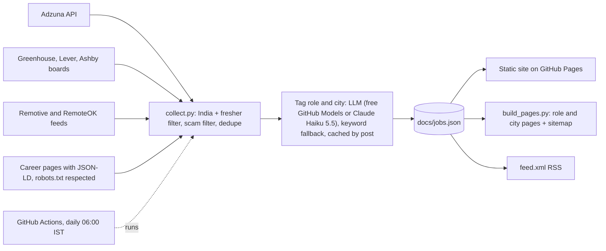

# JoBearth

Fresher and internship jobs across India, collected from public sources that allow it, tagged by role and city, and refreshed every morning without anyone touching it.

**Live site:** https://papaplayer01.github.io/jobearth/  |  **Contact:** jobearthh@gmail.com

## Architecture

Everything runs inside one GitHub repository. A scheduled GitHub Action runs `collector/collect.py`, which pulls posts from the sources above, keeps only India posts that look entry-level, drops scam-looking posts, removes duplicates (exact company + title + city match, then fuzzy title match), tags each new post with an LLM, and writes `docs/jobs.json`. The same run builds an RSS feed and static role and city pages with a sitemap, then commits the results. GitHub Pages serves `docs/` as a static site with search, role and city filters, a "My skills" ranking box and a light and dark theme. There is no server and no database.

**Sources and terms.** Naukri, LinkedIn, Indeed and Internshala forbid scraping in their terms, so they are not used. The sources are official APIs and public boards (Adzuna, Greenhouse, Lever, Ashby, Remotive, RemoteOK) and career pages that publish schema.org JobPosting data, checked against robots.txt first. Adzuna, Remotive and RemoteOK are credited in the site footer as their terms ask.

**Tagging.** The LLM is GitHub Models (openai/gpt-4o-mini) when only the workflow's built-in token is available, which is free, or Claude Haiku 5.5 when `ANTHROPIC_API_KEY` is set. Each post is tagged once and cached in `collector/tag_cache.json`, so cost only grows with new posts. Without an API key, or if a call fails, plain keyword rules tag the post instead. Every tag records which tagger made it (`by`: `llm` or `kw`), so accuracy can be measured separately.

## What broke and how I fixed it

| What I saw | Cause | Fix |
|---|---|---|
| Site showed 1 job; log said Adzuna 0 | The API secrets were never saved to GitHub | Added them with `gh secret set`; total went from 1 to 226 |
| Run crashed with `KeyError: last_seen` | Sample posts had no `last_seen` field | Merge step ignores entries without it |
| Push rejected (fetch first) | Overlapping runs raced to push | Concurrency group and `git pull --rebase` before push |
| Runs stuck in Queued | Backlog of runs I triggered while earlier ones were stuck | Cancelled the backlog; one run at a time |
| Many 404s from company boards | I guessed the board names | Failures are skipped; `check_sources.py` tests candidates and keeps working ones |
| Scam-looking posts in real data | Aggregator feeds include paid-placement ads | Scam-phrase filter, applied to saved posts too |
| Wrong tags (HR post tagged Mobile, locality used as city) | Keyword rules read words in descriptions; city took the wrong part of the location | Role from title, then Adzuna category; better city parsing; LLM tagging |
| Details popup felt empty | Cards depended on a drawer | Whole card is a link, with Save and Apply |

## Accuracy and cost

The 50-post hand-check and the cost calculation are in `evaluation/JoBearth_evaluation.xlsx`. Reproduce the sample with `python3 evaluation/eval_sample.py make` (fixed seed 42), fill in the correct role and city, then run `python3 evaluation/eval_sample.py score`. Each run with an API key logs real token use to `collector/usage_log.json`.

Results (update after the hand-check):

| Measure | Result |
|---|---|
| Role accuracy, site tags (n=50) | _to fill_ |
| City accuracy, site tags (n=50) | _to fill_ |
| Keyword baseline, same 50 posts | _to fill_ |
| LLM cost per 1,000 posts, measured | _to fill_ |

If the free GitHub Models route is used, the real cost is $0 and `usage_log.json` records the tokens plus the price the same tokens would cost on Claude Haiku 5.5 (`equivalent_haiku_cost_usd`). Before measuring, the estimate is about 114,000 input and 25,000 output tokens per 1,000 posts. At Claude Haiku 5.5's listed price of $0.10 input and $0.50 output per million tokens for prompts up to 100K, that is about $0.024 per 1,000 posts (roughly Rs 2). This is an estimate built from the prompt size, not a measurement. The price comes from secondary sources quoting Anthropic's pricing page, so check platform.claude.com/docs/en/about-claude/pricing.

## Run it yourself

1. Fork the repo and enable Pages from `main` and `/docs`.
2. Tagging needs no secret: the workflow's built-in token calls GitHub Models for free (`models: read` is already set). For Claude instead, add `ANTHROPIC_API_KEY`. Add `ADZUNA_APP_ID` and `ADZUNA_APP_KEY` (free at developer.adzuna.com). `JOOBLE_KEY`, `TELEGRAM_BOT_TOKEN` and `TELEGRAM_CHAT_ID` are optional.
3. Run the "Find working job boards" workflow once, then "Daily refresh".

## Limits

Posts are short snippets from the sources, and the apply link on each card goes to the original post. Fresher detection is keyword based, so some senior posts slip through and some real fresher posts are missed. Tag accuracy is measured on 50 posts labelled by one person.
